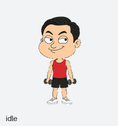
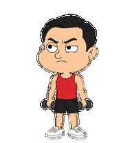
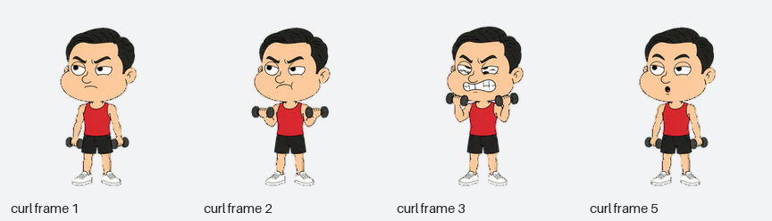

# 薄肌孙哥 · Thin-Muscle Sun

[简体中文](README.zh-CN.md) · [English](README.md) · [MIT 开源许可](LICENSE)

以孙宇晨 Justin Sun 为原型的幽默健身卡通：大头、细胳膊、小哑铃，练薄肌的态度非常认真。

美式成人情景喜剧的 2D 卡通画风：粗黑线、平涂色彩，与 [看戏峰哥 · Spectator Feng](https://github.com/Yixiang-Li/spectator-feng-pet) 属于同一个卡通宇宙。



## 把链接丢给 AI

在能读取 GitHub、下载文件并调用 Pets 工具的 AI 中使用，例如已启用 Pets 插件的 Codex。直接复制下面这段：

```text
读取这个仓库及其 AGENTS.md：
https://github.com/Yixiang-Li/thin-muscle-sun-pet

使用仓库里现成的精灵图，帮我创建一个叫「薄肌孙哥」的 Pets 宠物并选中它。
请自行获取和校验文件，完成后确认我的账号已启用这个宠物。
```

获取文件、校验、创建和启用都交给 AI，你只需要提供链接和要求。

### 让 AI 改造

```text
读取这个仓库及其 AGENTS.md：
https://github.com/Yixiang-Li/thin-muscle-sun-pet

以这个人物为参考，把专注工作时的动画改成[你想要的动作]。
保留脸、身材、服装和卡通画风，保持完整的 Pets 动画布局。
先给我看动画预览，再创建并选中这个新版本。
```

[AGENTS.md](AGENTS.md) 提供给 AI 读取，说明文件位置、导入与验证流程，以及改造时需要保留的规则。

## 手动下载（可选）

- [下载透明精灵图 PNG](https://github.com/Yixiang-Li/thin-muscle-sun-pet/raw/refs/heads/main/assets/spritesheet.png)
- [完整动画视频](previews/all-states.mp4)
- [十六方向循环](previews/look-loop.gif)
- [全部动作帧](docs/contact-sheet.png) · [方向总览](docs/directions.png)

也可以自己下载 PNG，附在启用 Pets 的聊天里，让 AI 创建并选中「薄肌孙哥」。

## 认真举小哑铃练薄肌





## 动画布局

透明 PNG 尺寸为 **1536 × 2288**：8 列 × 11 行，每格 **192 × 208**。共有 73 个有效帧，另有 15 个完全透明的空格。行列索引从 0 开始，详细数据见 [manifest.json](manifest.json)。

| 行 | 状态 | 帧数 | 动作 |
| --- | --- | ---: | --- |
| 0 | `idle` | 6 | 呼吸和眨眼 |
| 1 | `running-right` | 8 | 向右跑 |
| 2 | `running-left` | 8 | 向左跑 |
| 3 | `waving` | 4 | 握着哑铃挥手 |
| 4 | `jumping` | 5 | 起跳和落地 |
| 5 | `failed` | 8 | 力竭后垂头 |
| 6 | `waiting` | 6 | 摊手等待回应 |
| 7 | `running` | 6 | 认真做哑铃弯举 |
| 8 | `review` | 6 | 欣赏自己的细胳膊 |
| 9 | 看向不同方向 | 8 | 顺时针 000°–157.5° |
| 10 | 看向不同方向 | 8 | 顺时针 180°–337.5° |

`000` 是上，`090` 是屏幕右侧，`180` 是下，`270` 是屏幕左侧。`running` 是专注工作时的动作；左右移动分别使用自己的动画。九种动作各自的 GIF 在 [previews/states](previews/states)。

## 源文件与改造

- [source/base.png](source/base.png)：人物主造型。
- [source/strips](source/strips)：最终采用的动作条与方向条。
- [prompts](prompts)：实际采用的生成提示词，以及派生动作说明。
- [scripts/render_previews.py](scripts/render_previews.py)：从最终 PNG 生成预览的可移植脚本。

画面由 OpenAI 图像生成工具绘制，经 Pets 创建流程完成提取、注册、组装和验证。仓库包含预览脚本；Pets 服务及插件内部工具属于独立依赖。相同提示词不保证重新生成相同画面。人物参考照片只保留来源链接。

使用 Python 3.10 或更新版本，即可生成预览并提取 57 个常规动作帧：

```bash
python -m pip install -r requirements.txt
python scripts/render_previews.py assets/spritesheet.png --output-dir generated-previews
```

## 验证结果

发布的 PNG 与已验证的宠物文件字节一致，结构、质量与 Pets 上传前检查均通过。跳跃最高离地 **29 px**，落地基线差 **0 px**。文件摘要及原检查结果见 [docs/validation.json](docs/validation.json)。

67.5° 和 247.5° 的中间姿态俯仰较细微，经完整循环复核后接受。四个主要方向均通过独立盲审。

## 许可与来源

本仓库原创生成图、提示词、文档与预览脚本采用 [MIT 开源许可](LICENSE)。人物为非官方幽默卡通演绎。详见 [来源与致谢](docs/CREDITS.md)。
